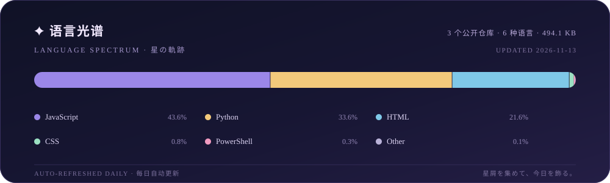

  

<h1 align="center">Qimin Shen</h1>

  <em>在月光与星尘之间，记录每一个崭新的今天。</em>

  <a href="https://github.com/Qimin-Shen"><b>GitHub</b></a>
  &nbsp;·&nbsp;
  <a href="https://qimin-shen.github.io/my-website/"><b>Website</b></a>
  &nbsp;·&nbsp;
  <a href="https://github.com/Qimin-Shen?tab=repositories"><b>Repositories</b></a>

  

<h2 align="center">🌙 今日月签 · Daily Check-in</h2>

<!-- daily-fortune-start -->

  <strong>🌖 泡沫のごとく、想いは昇華す。</strong> 
  ☾ ─── ✦ ─── ☽ 
  🌫️ 今日の運勢：末吉 — 运转微妙，勿急勿躁。 
  🗓️ 2026-11-09

<!-- daily-fortune-end -->

<h2 align="center">✦ GitHub 星轨 · Star Track</h2>

  

  
   
  ☾ Kirino · 高坂桐乃

  

  月は満ち欠けても、星はいつもそこに。

